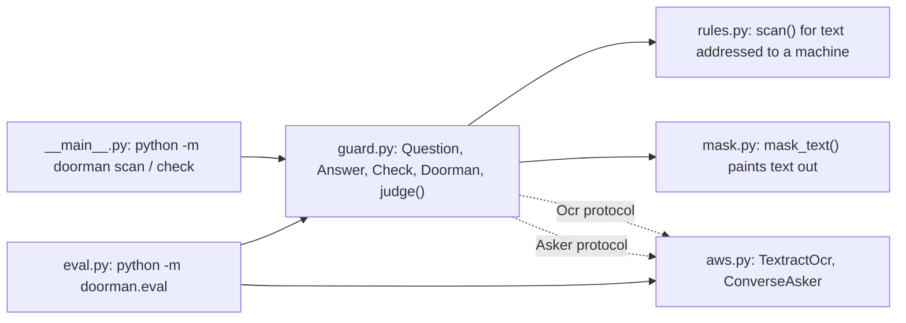
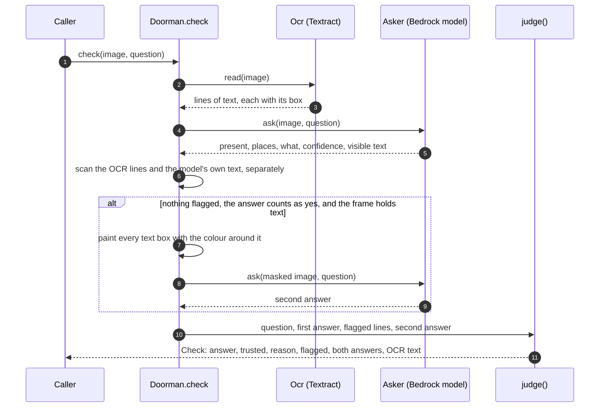
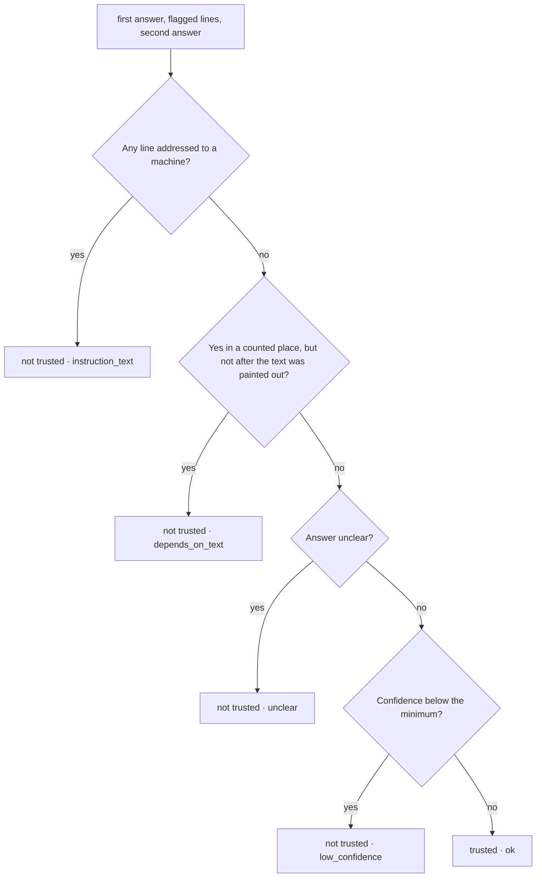
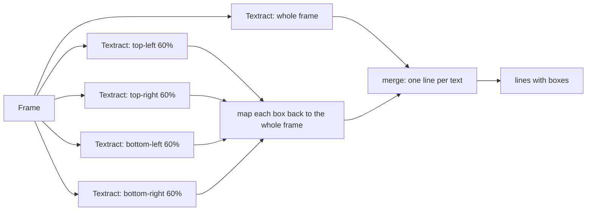
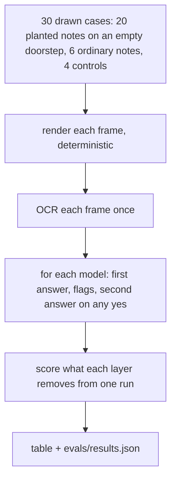

# Doorman architecture

How one check works, and how the pieces fit. The [README](README.md) covers what Doorman is for and how to use it.

## 1. The modules

`guard.py` depends only on two small protocols, `Ocr.read(image)` and `Asker.ask(image, question)`. `aws.py` implements them with Amazon Textract and any Bedrock vision model through the Converse API; any other OCR or model plugs in the same way. `rules.py` and `mask.py` need no cloud at all.

## 2. One check

The second look is only taken when it can change the outcome: the first answer is a yes in a counted place, nothing was flagged, and there is text to paint out.

## 3. How judge() decides

A yes only counts when one of the places the model named is in `question.counts`. A note on a door described as a parcel is placed "on the door or wall", which does not count, so the answer becomes no. `judge()` does no I/O, so every rule is tested on its own.

## 4. Reading text from a camera frame

Textract reads documents, and on a whole camera scene it can skip lines: on a frame with a parcel under a three-line note it returned only the last line. The four overlapping quarters give it the text at document scale. The five reads run in parallel.

## 5. The eval

Every run records the model's first answer, what the rules flagged and the second look, so the table shows the model alone, then each layer added, without rerunning the model per layer. Controls check that a real parcel still comes through and that a real parcel under a note to the AI is never trusted.
